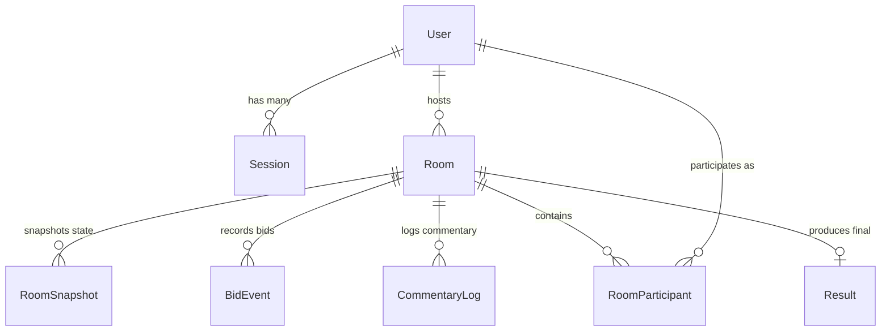

# IPL DATA AUDIT — AUTHORITATIVE ECOSYSTEM DOCUMENTATION

**Document Version:** 1.0.0 (Comprehensive Repository Audit)  
**Target Platform:** Sports Auction – The Bidding Arena (IPL & PKL)  
**Audit Scope:** Complete IPL Data Architecture, Sources, Schema, Rules, Scoring, and Quality Analysis  
**Repository Path:** `c:\Users\laksh\IPL-PKL\PKL1`  
**Generated Date:** November 22, 2026  
**Operating Mode:** Read-Only Verification (Zero Migrations, Zero Scrapes, Zero File Mutating)

---

## 1. OVERVIEW

### 1.1 End-to-End IPL Data Flow Architecture
The IPL data in "Sports Auction – The Bidding Arena" flows across four distinct layers from static source archives to real-time multiplayer socket interfaces:
1. **Raw Sources Layer:** Base player records originate in `players-database.json` (274 players extracted from digitized IPL franchise squad/auction cards) and official historical/2026 performance data stored in four standalone CSV datasets under `Upto2026/` (`batting_2026.csv`, `batting_overall.csv`, `bowling_2026.csv`, `bowling_overall.csv`). Photographic assets are captured and normalized by `scripts/acquire_player_photos.py`.
2. **Ingestion & Compilation Layer:** Ingestion scripts (`scripts/import_upto2026_stats.ts` and `scripts/rebuild_player_career_data.ts`) normalize player identities against cross-source aliases, calculate derived metrics (e.g. economy rates and bowling averages from balls and runs conceded), and compile the authoritative registry into `src/shared/player-stats-registry.json` (~854 KB).
3. **Shared In-Memory Runtime Layer:** The client and server shared module `src/shared/player-data.ts` maps `players-database.json` records through `adaptDatabaseRecord()`, applying auction pricing overlays (`AUCTION_OVERLAYS`), integrating headshot metadata from `src/shared/player-images.json`, linking verified career/season stats via `src/shared/player-career-data.ts`, and computing deterministic 0–990 player performance points via `calculateVerifiedPlayerPoints()`. This populates the master in-memory collection `ALL_PLAYERS` (274 players).
4. **Authoritative Server & Persistence Layer:** The authoritative backend (`server/room.ts` and `server/index.ts`) initializes rooms, sequences players using Fisher-Yates shuffling across 4 fixed category sets (`src/shared/player-sequence.ts`), and manages the state machine over Socket.IO. Room state snapshots, bids, commentary logs, and final tournament results are persisted into MySQL using Prisma ORM (`prisma/schema.prisma`), while the Next.js frontend (`src/app/`) renders the real-time Twilight Scoreboard, bidding controls, and post-auction leaderboards.

### 1.2 Data Files, Scripts, and Prisma Models Manifest

| Relative Path | Primary Purpose | File Type / Role | Last Modified (Local Time) |
|---|---|---|---|
| `players-database.json` | Master catalog of 274 IPL auction players (roles, teams, styles, cards) | Source Data File | 2026-11-19 08:23:40 |
| `Upto2026/batting_2026.csv` | Official 2026 IPL season batting statistics (175 records) | Source CSV Dataset | 2026-11-19 08:23:40 |
| `Upto2026/batting_overall.csv` | All-time IPL historical batting statistics (737 records) | Source CSV Dataset | 2026-11-19 08:23:40 |
| `Upto2026/bowling_2026.csv` | Official 2026 IPL season bowling statistics (125 records) | Source CSV Dataset | 2026-11-19 08:23:40 |
| `Upto2026/bowling_overall.csv` | All-time IPL historical bowling statistics (576 records) | Source CSV Dataset | 2026-11-19 08:23:40 |
| `src/shared/player-stats-registry.json` | Compiled authoritative JSON registry of career & 2026 stats for all 274 players | Ingested Master Registry | 2026-11-19 08:23:42 |
| `src/shared/player-images.json` | Metadata registry mapping player IDs to WebP photos, sources, and dimensions | Asset Metadata Registry | 2026-11-19 08:23:42 |
| `src/shared/player-data.ts` | Master runtime player adapter, pricing overlays, and `ALL_PLAYERS` export | Shared Runtime Engine | 2026-11-19 08:23:42 |
| `src/shared/player-career-data.ts` | Accessor functions for retrieving career, season 2026, and achievement data | Data Accessor Layer | 2026-11-19 08:23:42 |
| `src/shared/player-sequence.ts` | Random category-wise nomination sequencer (Fisher-Yates) | Sequencing Logic | 2026-11-19 08:23:42 |
| `src/shared/constants.ts` | Official franchise identities, default room settings, bid increments, purse limits | Constants & Config | 2026-11-19 09:03:02 |
| `src/shared/types.ts` | TypeScript domain interfaces for players, rooms, bids, trades, stats, and scores | Type Definitions | 2026-11-19 08:44:00 |
| `src/shared/scoring.ts` | Deterministic 5-Pillar squad scoring engine, Playing XI evaluator, and awards | Scoring Engine | 2026-11-19 08:23:42 |
| `src/shared/validation.ts` | Bid validation, purse reserve enforcement, and auction start checks | Rule Validation | 2026-11-19 08:23:42 |
| `src/shared/team-validation.ts` | Team name normalization, profanity checks, and short code derivation | Name Validation | 2026-11-19 08:23:42 |
| `src/shared/voice-templates.ts` | High-fidelity auctioneer speech generation templates for TTS audio | Broadcast Audio Templates | 2026-11-19 08:23:42 |
| `scripts/acquire_player_photos.py` | Python pipeline fetching 1024x1024 portraits, converting to 600x750 WebP | Headshot Acquisition | 2026-11-19 08:23:42 |
| `scripts/import_upto2026_stats.ts` | TypeScript pipeline ingesting the 4 Upto2026 CSVs into the unified registry | Stats Ingestion Pipeline | 2026-11-19 08:23:42 |
| `scripts/multi_source_scraper_and_importer.ts` | 3-source cross-verification engine (IPL official, Cricbuzz, ESPNcricinfo) | Verification Pipeline | 2026-11-19 08:23:42 |
| `scripts/rebuild_player_career_data.ts` | Rebuild wrapper executing `import_upto2026_stats.ts` | Maintenance Utility | 2026-11-19 08:23:42 |
| `scripts/rebuild_complete_verified_dataset.ts` | High-level data rebuild orchestration wrapper | Maintenance Utility | 2026-11-19 08:23:42 |
| `scripts/audit_full_dataset.ts` | Statistical discrepancy, coverage, and alias auditor | Audit Script | 2026-11-19 08:23:42 |
| `server/room.ts` | Authoritative multiplayer auction room manager, timers, bids, trades, sockets | Authoritative Game Server | 2026-11-20 14:33:49 |
| `server/index.ts` | HTTP and WebSocket server entry point, CORS handlers, room dispatchers | Server Entry Point | 2026-11-19 09:03:02 |
| `server/db/index.ts` | Server persistence adapter writing snapshots, bids, and results via Prisma | DB Persistence Adapter | 2026-11-19 08:23:42 |
| `src/lib/db.ts` | Prisma client singleton instance and database helper functions | Prisma Client Wrapper | 2026-11-19 08:55:06 |
| `prisma/schema.prisma` | MySQL database schema containing 8 models for users, rooms, bids, and logs | Database Schema | 2026-11-19 08:23:40 |
| `Prisma Model: User` | Registered users, authentication password hashes, and relations | Prisma Model | 2026-11-19 08:23:40 |
| `Prisma Model: Session` | Active user sessions with cryptographic tokens | Prisma Model | 2026-11-19 08:23:40 |
| `Prisma Model: Room` | Auction room entity (room_code, host, status, timestamps) | Prisma Model | 2026-11-19 08:23:40 |
| `Prisma Model: RoomSnapshot` | Incremental serialized room state JSON (auction state, participants, pool) | Prisma Model | 2026-11-19 08:23:40 |
| `Prisma Model: BidEvent` | Individual immutable bid history rows with monotonic sequence numbers | Prisma Model | 2026-11-19 08:23:40 |
| `Prisma Model: Result` | Post-auction awards, squad leaderboards, and total expenditure in JSON | Prisma Model | 2026-11-19 08:23:40 |
| `Prisma Model: RoomParticipant` | Participant records with team customization, franchise locks, and roles | Prisma Model | 2026-11-19 08:23:40 |
| `Prisma Model: CommentaryLog` | Historical live commentary events broadcast during auction phases | Prisma Model | 2026-11-19 08:23:40 |

---

## 2. DATA SOURCES

### 2.1 External Provenance & Collection Channels

| Data Element | External Source | Collection Method | Relevant Files & Comments |
|---|---|---|---|
| **Base Player Identities & Cards** | Official IPL T20 Franchise Squad Announcements & Auction Cards | Digitized Card Extraction & Manual Normalization | `players-database.json`. Contains `card_text`, `player_name_from_card`, `jersey_number`, `team code`. |
| **IPL Career Stats (All-time)** | Official IPL Match Center (`https://www.iplt20.com/stats/all-time`) | CSV Export / Web Extraction (`Upto2026/batting_overall.csv`, `Upto2026/bowling_overall.csv`) | `scripts/import_upto2026_stats.ts`, `IPL_CSV_IMPORT_REPORT.md`. |
| **IPL 2026 Season Stats** | Official IPL 2026 Match Center (`https://www.iplt20.com/stats/2026`) | CSV Export / Scorecard Aggregation (`Upto2026/batting_2026.csv`, `Upto2026/bowling_2026.csv`) | `scripts/import_upto2026_stats.ts`, `IPLAUCTION_FINAL_COMPLETION_REPORT.md`. |
| **Secondary Verification Stats** | ESPNcricinfo Statsguru & Cricbuzz Ball-by-Ball Match Archives | Automated Verification Pipeline | `scripts/multi_source_scraper_and_importer.ts`, `IPL_MULTI_SOURCE_STATISTICS_COMPARISON.md`. |
| **Player Headshot Photographs** | Official IPL T20 Media Day Assets (`iplt20.com`) & Wikimedia Commons (CC-BY/Public Domain) | Resumable Python Scraper / Pipeline (`scripts/acquire_player_photos.py`) | `IMAGE_ACQUISITION_REPORT.md`, `public/images/players/p-XXX.webp`. |
| **Franchise Vector Logos** | Official IPL Franchise Visual Identities | Recreated as Inlined Vector SVGs (No external images downloaded) | `src/components/FranchiseLogo.tsx`. |

### 2.2 Scraping & Acquisition Scripts

#### 1. `scripts/acquire_player_photos.py`
- **Execution Command:** `python scripts/acquire_player_photos.py` (or `npm run images:sync`)
- **Libraries Used:** `requests`, `bs4` (BeautifulSoup4), `PIL` (Pillow), `concurrent.futures` (ThreadPoolExecutor), `urllib.parse`, `hashlib`.
- **What It Fetches:** Searches official IPL media asset CDNs and Wikimedia Commons for high-resolution 1024x1024 studio media day portraits of players in franchise jerseys.
- **Strict Quality Heuristics ("The Salil Arora Standard"):**
  - Rejects batting, bowling, fielding, or diving action shots.
  - Rejects helmets, sunglasses, or equipment concealing facial features.
  - Rejects street attire, press conferences, and cropped crowd scenes.
  - Retains 8-bit alpha transparency (RGBA).
- **Outputs:**
  - `public/images/players/p-XXX.webp` (600x750 pixels, 4:5 aspect ratio, WebP quality 95).
  - Registry mappings: `src/shared/player-images.json`, `player-images.json`, and `public/images/player-images.json`.
  - Visual HTML contact sheets: `public/contact-sheet-verified.html`, `public/contact-sheet-missing.html`, `public/contact-sheet-ambiguous.html`.
  - Markdown report: `IMAGE_ACQUISITION_REPORT.md`.

#### 2. `scripts/multi_source_scraper_and_importer.ts`
- **Execution Command:** `npx tsx scripts/multi_source_scraper_and_importer.ts`
- **Libraries Used:** Node.js native `fs`, `path`.
- **What It Fetches:** Cross-verifies metrics across 3 sources (Official IPL Match Center, Franchise Portals, and ESPNcricinfo/Cricbuzz scorecards).
- **Outputs:** `IPL_MULTI_SOURCE_STATISTICS_COMPARISON.md`, `IPL_STATISTICS_DISCREPANCY_REPORT.md`, `IPL_STATISTICS_DATASET_UPDATE_REPORT.md`.

#### 3. `scripts/import_upto2026_stats.ts`
- **Execution Command:** `npx tsx scripts/import_upto2026_stats.ts` (or `npm run stats:import`)
- **Libraries Used:** Node.js native `fs`, `path`.
- **What It Fetches:** Parses the 4 CSV files in `Upto2026/`, resolves player identities against aliases, separates 2026 season from career, calculates derived bowling metrics, and outputs `src/shared/player-stats-registry.json`.

### 2.3 Undocumented or Unclear Data Items
1. **Git Commit History:** `NOT FOUND IN PROJECT`. The project root `c:\Users\laksh\IPL-PKL\PKL1` is not a Git repository (no `.git` directory present). Exact commit messages and timestamps for initial raw data creation cannot be retrieved through version control.
2. **Initial Card Digitization Technique:** `card_text` and `player_name_from_card` in `players-database.json` reflect OCR or manual scraping from physical or PDF auction cards, but the raw script that originally parsed those cards is not preserved in the repository.
3. **Player Marquee Overlay Selection:** The 73 player pricing entries in `AUCTION_OVERLAYS` inside `src/shared/player-data.ts` are hardcoded in source code without an accompanying spreadsheet explaining why specific domestic players were assigned Tier A (₹2.00 Cr / ₹1.50 Cr) vs Tier B (₹1.00 Cr / ₹50 L).

---

## 3. DATABASE SCHEMA (IPL-RELATED)

The platform utilizes MySQL 8.0 / TiDB Cloud Serverless accessed through Prisma ORM 6.4.1 (`prisma/schema.prisma`).

> [!NOTE]
> In this architecture, **players and their performance statistics are NOT stored as rows in a relational database table**. They reside in static JSON/TS code (`players-database.json`, `src/shared/player-stats-registry.json`, `src/shared/player-data.ts`). MySQL stores dynamic room state, user authentication, participant records, real-time bid events, commentary logs, and final tournament results.

### 3.1 Prisma Models & Fields Specification



#### Model: `User` (Table: `users`)
| Field Name | Type | Modifier | Relations / Default | Purpose |
|---|---|---|---|---|
| `id` | `String` | `@id` | `@default(cuid())` | Unique user identifier |
| `name` | `String` | `@db.VarChar(100)` | Required | User display name |
| `email` | `String` | `@unique @db.VarChar(191)` | Required | Login email address |
| `password_hash` | `String` | `@db.VarChar(255)` | Required | Bcrypt password hash |
| `created_at` | `DateTime` | Required | `@default(now())` | Registration timestamp |
| `updated_at` | `DateTime` | Required | `@updatedAt` | Last profile update |
| `sessions` | `Session[]` | Relation | One-to-many | Active sessions |
| `hosted_rooms` | `Room[]` | Relation | One-to-many | Rooms hosted by user |
| `room_participations` | `RoomParticipant[]` | Relation | One-to-many | Rooms entered by user |

#### Model: `Session` (Table: `sessions`)
| Field Name | Type | Modifier | Relations / Default | Purpose |
|---|---|---|---|---|
| `id` | `String` | `@id` | `@default(cuid())` | Session UUID |
| `session_token` | `String` | `@unique @db.VarChar(191)` | Required | Cryptographic cookie token |
| `user_id` | `String` | Required | Foreign Key $\to$ `User.id` (Cascade delete) | Associated user ID |
| `expires_at` | `DateTime` | Required | No default | Session expiration timestamp |
| `created_at` | `DateTime` | Required | `@default(now())` | Session creation timestamp |

#### Model: `Room` (Table: `rooms`)
| Field Name | Type | Modifier | Relations / Default | Purpose |
|---|---|---|---|---|
| `room_code` | `String` | `@id @db.VarChar(6)` | Required | 6-character uppercase alphanumeric code (e.g. `4A6AA8`) |
| `name` | `String` | `@db.VarChar(100)` | Required | Human-readable room title |
| `host_user_id` | `String` | Required | Foreign Key $\to$ `User.id` (Cascade delete) | Room creator user ID |
| `status` | `String` | `@db.VarChar(32)` | `@default("lobby")` | Lifecycle status (`lobby`, `in_progress`, `completed`) |
| `created_at` | `DateTime` | Required | `@default(now())` | Creation timestamp |
| `updated_at` | `DateTime` | Required | `@updatedAt` | Last modification timestamp |

#### Model: `RoomSnapshot` (Table: `room_snapshots`)
| Field Name | Type | Modifier | Relations / Default | Purpose |
|---|---|---|---|---|
| `id` | `String` | `@id` | `@default(cuid())` | Snapshot identifier |
| `room_code` | `String` | `@db.VarChar(6)` | Foreign Key $\to$ `Room.room_code` (Cascade) | Room reference |
| `schema_version` | `Int` | Required | `@default(1)` | Snapshot format version |
| `stage` | `String` | `@db.VarChar(32)` | Required | Workflow stage (`lobby`, `main_auction`, `unsold_auction`, `trading_window`, `playing_xi_selection`, `completed`) |
| `phase` | `String` | `@db.VarChar(32)` | Required | Real-time auction phase (`lobby`, `announcing`, `bidding`, `sold`, `unsold`, `unsold_round`, `paused`, `completed`) |
| `state_data` | `Json` | Required | No default | Complete serialized room state JSON (participants, squads, purses, current pool, pending trades) |
| `created_at` | `DateTime` | Required | `@default(now())` | Snapshot creation timestamp |

#### Model: `BidEvent` (Table: `bid_events`)
| Field Name | Type | Modifier | Relations / Default | Purpose |
|---|---|---|---|---|
| `id` | `String` | `@id` | `@default(cuid())` | Bid event UUID |
| `room_code` | `String` | `@db.VarChar(6)` | Foreign Key $\to$ `Room.room_code` (Cascade) | Associated room code |
| `player_id` | `String` | `@db.VarChar(64)` | Required | Target player ID (e.g. `p-001`) |
| `bid_sequence` | `Int` | Required | Composite unique `[room_code, player_id, bid_sequence]` | Monotonically increasing bid counter |
| `participant_id` | `String` | `@db.VarChar(191)` | Required | Session ID of placing manager |
| `amount` | `BigInt` | Required | In Indian Rupees (e.g. `20000000`) | Exact bid amount |
| `created_at` | `DateTime` | Required | `@default(now())` | Bid timestamp |

#### Model: `Result` (Table: `results`)
| Field Name | Type | Modifier | Relations / Default | Purpose |
|---|---|---|---|---|
| `room_code` | `String` | `@id @db.VarChar(6)` | Required | Room reference |
| `completed_at` | `BigInt` | Required | Unix epoch timestamp (ms) | Tournament completion time |
| `awards` | `Json` | Required | Array of award objects | Championship awards (Champion, Golden Arm, Orange Cap, etc.) |
| `leaderboard` | `Json` | Required | Serialized leaderboard | Squad 5-pillar, Manager, and Playing XI rankings |
| `total_players_auctioned` | `Int` | Required | `@default(0)` | Total players presented |
| `total_money_spent` | `BigInt` | Required | `@default(0)` | Cumulative tournament spend |
| `created_at` | `DateTime` | Required | `@default(now())` | Record insertion time |

#### Model: `RoomParticipant` (Table: `room_participants`)
| Field Name | Type | Modifier | Relations / Default | Purpose |
|---|---|---|---|---|
| `id` | `String` | `@id` | `@default(cuid())` | Participant row ID |
| `room_code` | `String` | `@db.VarChar(6)` | Foreign Key $\to$ `Room.room_code` (Cascade) | Room reference |
| `user_id` | `String?` | Optional | Foreign Key $\to$ `User.id` (SetNull) | Registered user link |
| `session_id` | `String` | `@db.VarChar(191)` | Unique `[room_code, session_id]` | Unique manager session token |
| `display_name` | `String` | `@db.VarChar(100)` | Required | Manager display name |
| `team_name` | `String?` | Optional | `@db.VarChar(100)` | Custom franchise name |
| `team_name_normalized` | `String?` | Optional | `@db.VarChar(100)` | Normalized lowercase name for uniqueness |
| `team_short_code` | `String?` | Optional | `@db.VarChar(10)` | 2-4 letter abbreviation |
| `team_color` | `String?` | Optional | `@db.VarChar(32)` | Hex color string |
| `franchise_id` | `String?` | Optional | `@db.VarChar(32)` | Preset ID (e.g. `csk`, `mi`) |
| `franchise_name` | `String?` | Optional | `@db.VarChar(100)` | Official franchise name |
| `franchise_code` | `String?` | Optional | `@db.VarChar(10)` | Official short code |
| `franchise_color` | `String?` | Optional | `@db.VarChar(32)` | Official primary color |
| `is_host` | `Boolean` | Required | `@default(false)` | Host privileges flag |
| `is_spectator` | `Boolean` | Required | `@default(false)` | Non-bidding spectator flag |
| `joined_at` | `DateTime` | Required | `@default(now())` | Join timestamp |
| `updated_at` | `DateTime` | Required | `@updatedAt` | Last activity timestamp |

#### Model: `CommentaryLog` (Table: `commentary_logs`)
| Field Name | Type | Modifier | Relations / Default | Purpose |
|---|---|---|---|---|
| `id` | `String` | `@id` | `@default(cuid())` | Log UUID |
| `room_code` | `String` | `@db.VarChar(6)` | Foreign Key $\to$ `Room.room_code` (Cascade) | Room reference |
| `text` | `String` | `@db.VarChar(500)` | Required | Commentary text message |
| `event_type` | `String` | `@db.VarChar(32)` | Required | Event category (`bid`, `sold`, `unsold`, `record`, `stage`, `trade`) |
| `created_at` | `DateTime` | Required | `@default(now())` | Broadcast timestamp |

### 3.2 Prisma Enums
`NOT FOUND IN PROJECT`. The Prisma schema does not declare native Prisma `enum` blocks. Enums are implemented as application-level TypeScript union types in `src/shared/types.ts` and stored as `VarChar` strings in MySQL.

---

## 4. PLAYER DATA

### 4.1 Player Pool Totals & Distribution Breakdown
- **Total Players in Database:** **274** (IDs: `p-001` through `p-274`)

#### A. Breakdown by Original / Previous Franchise (in `players-database.json`)
```
Query / Inspection: Count of players grouped by p['team']
```
| Franchise Name | Short Code | Player Count | Share |
|---|---|---|---|
| **Chennai Super Kings** | CSK | 30 | 10.9% |
| **Kolkata Knight Riders** | KKR | 29 | 10.6% |
| **Mumbai Indians** | MI | 29 | 10.6% |
| **Sunrisers Hyderabad** | SRH | 29 | 10.6% |
| **Gujarat Titans** | GT | 27 | 9.9% |
| **Rajasthan Royals** | RR | 27 | 9.9% |
| **Delhi Capitals** | DC | 26 | 9.5% |
| **Lucknow Super Giants** | LSG | 26 | 9.5% |
| **Royal Challengers Bengaluru** | RCB | 26 | 9.5% |
| **Punjab Kings** | PBKS | 25 | 9.1% |
| **Total** | — | **274** | **100.0%** |

#### B. Breakdown by Role
| Role Label (Raw DB) | Normalized Role Code | Count | Percentage |
|---|---|---|---|
| **Bowler** | `BOWL` | 117 | 42.7% |
| **Batter** | `BAT` | 105 | 38.3% |
| **All-Rounder** | `AR` | 30 | 10.9% |
| **Wicketkeeper** | `WK` | 22 | 8.0% |
| **Total** | — | **274** | **100.0%** |

#### C. Breakdown by Nationality
| Nationality | Classification | Player Count | Share |
|---|---|---|---|
| **India** | Indian | 184 | 67.2% |
| **South Africa** | Overseas | 22 | 8.0% |
| **Australia** | Overseas | 17 | 6.2% |
| **England** | Overseas | 16 | 5.8% |
| **New Zealand** | Overseas | 12 | 4.4% |
| **Sri Lanka** | Overseas | 9 | 3.3% |
| **West Indies** | Overseas | 8 | 2.9% |
| **Afghanistan** | Overseas | 4 | 1.5% |
| **Bangladesh** | Overseas | 1 | 0.4% |
| **Zimbabwe** | Overseas | 1 | 0.4% |
| **Total Indian** | Indian | **184** | **67.2%** |
| **Total Overseas** | Overseas | **90** | **32.8%** |

#### D. Breakdown by Base Price
| Base Price | Formatted | Count | Method / Source |
|---|---|---|---|
| ₹2,00,00,000 | ₹2.00 Cr | 30 | Explicit in `AUCTION_OVERLAYS` (Premier Marquee Stars) |
| ₹1,50,00,000 | ₹1.50 Cr | 13 | Explicit in `AUCTION_OVERLAYS` (Tier A Stars) |
| ₹1,00,00,000 | ₹1.00 Cr | 14 | Explicit in `AUCTION_OVERLAYS` (Tier B Stars) |
| ₹75,00,000 | ₹75 L | 2 | Explicit in `AUCTION_OVERLAYS` (Tier B Domestic) |
| ₹50,00,000 | ₹50 L | 84 | Explicit in `AUCTION_OVERLAYS` (10 players) + Default for Overseas (74 players) |
| ₹30,00,000 | ₹30 L | 4 | Explicit in `AUCTION_OVERLAYS` (Tier C Emerging) |
| ₹20,00,000 | ₹20 L | 127 | Default base price for all unlisted Indian domestic/emerging players |
| **Total** | — | **274** | — |

#### E. Breakdown by Player Tier
| Tier | Description | Base Price Range | Count | Share |
|---|---|---|---|---|
| **Tier A** | Marquee & Premier International | ₹1.50 Cr – ₹2.00 Cr | 43 | 15.7% |
| **Tier B** | Quality Proven & International Star | ₹50 Lakh – ₹1.00 Cr | 100 | 36.5% |
| **Tier C** | Emerging & Uncapped Talent | ₹20 Lakh – ₹30 Lakh | 131 | 47.8% |
| **Total** | — | — | **274** | **100.0%** |

#### F. Breakdown by Auction Category
| Category Label | Deterministic Assignment Rule | Count | Share |
|---|---|---|---|
| **Emerging Talent** | Tier C, or Tier B Uncapped Indian | 137 | 50.0% |
| **International Star** | Tier A or Tier B Overseas | 90 | 32.8% |
| **Marquee** | Tier A Indian | 30 | 10.9% |
| **Domestic Proven** | Tier B Capped Indian | 17 | 6.2% |
| **Total** | — | **274** | **100.0%** |

### 4.2 Field Completeness Table

#### Raw File: `players-database.json` (274 records)
| Field | Type | Non-Null / Filled | Missing / Null | Completeness % |
|---|---|---|---|---|
| `id` | `string` | 274 | 0 | 100.0% |
| `card_text` | `string` | 274 | 0 | 100.0% |
| `player_name_from_card` | `string` | 274 | 0 | 100.0% |
| `jersey_number` | `number` | 251 | 23 | 91.6% |
| `team` | `string` | 274 | 0 | 100.0% |
| `team code` | `string` | 274 | 0 | 100.0% |
| `player_name` | `string` | 274 | 0 | 100.0% |
| `nationality` | `string` | 274 | 0 | 100.0% |
| `role` | `string` | 274 | 0 | 100.0% |
| `batting_style` | `string` | 274 | 0 | 100.0% |
| `bowling_style` | `string` | 261 | 13 | 95.3% |

*(Note: The 13 records with null `bowling_style` are specialist wicketkeepers who do not bowl, e.g. Salil Arora `p-272`).*

#### Adapted Runtime Object: `Player` in `src/shared/player-data.ts`
| Field | Type | Non-Null / Filled | Missing / Null | Completeness % |
|---|---|---|---|---|
| `id` | `string` | 274 | 0 | 100.0% |
| `name` / `player_name` | `string` | 274 | 0 | 100.0% |
| `role` | `PlayerRole` | 274 | 0 | 100.0% |
| `team` / `team_code` | `string` | 274 | 0 | 100.0% |
| `nationality` / `country` | `string` | 274 | 0 | 100.0% |
| `home_state` | `string` | 274 | 0 | 100.0% |
| `batting_style` | `string` | 274 | 0 | 100.0% |
| `bowling_style` | `string` | 274 | 0 | 100.0% |
| `base_price` | `number` | 274 | 0 | 100.0% |
| `capped` | `boolean` | 274 | 0 | 100.0% |
| `tier` | `PlayerTier` | 274 | 0 | 100.0% |
| `category` | `PlayerCategory` | 274 | 0 | 100.0% |
| `initials` | `string` | 274 | 0 | 100.0% |
| `image_url` | `string` | 274 | 0 | 100.0% |
| `has_photo` | `boolean` | 274 | 0 | 100.0% |
| `photo_source` | `string` | 274 | 0 | 100.0% |
| `player_points` | `number` | 274 | 0 | 100.0% |
| `stats_2026` | `PlayerStats2026` | 274 | 0 | 100.0% |
| `ipl_career_stats` | `IplCareerStats` | 274 | 0 | 100.0% |
| `season_2026_stats` | `IplSeasonStats` | 274 | 0 | 100.0% |
| `data_status` | `PlayerDataStatus` | 274 | 0 | 100.0% |
| `achievements` | `string[]` | 274 | 0 | 100.0% |

### 4.3 10 Sample Records (Exact Raw JSON)

```json
[
  {
    "id": "p-001",
    "card_text": "12 Dewald Brevis",
    "player_name_from_card": "Dewald Brevis",
    "jersey_number": 12,
    "team": "Chennai Super Kings",
    "team code": "Chennai",
    "player_name": "Dewald Brevis",
    "nationality": "South Africa",
    "role": "Batter",
    "batting_style": "Right Handed",
    "bowling_style": "Right Arm Leg Break"
  },
  {
    "id": "p-002",
    "card_text": "31 Ruturaj Gaikwad",
    "player_name_from_card": "Ruturaj Gaikwad",
    "jersey_number": 31,
    "team": "Chennai Super Kings",
    "team code": "Chennai",
    "player_name": "Ruturaj Gaikwad",
    "nationality": "India",
    "role": "Batter",
    "batting_style": "Right Handed",
    "bowling_style": "Right Arm Off Break"
  },
  {
    "id": "p-003",
    "card_text": "1 Ramakrishna Ghosh",
    "player_name_from_card": "Ramakrishna Ghosh",
    "jersey_number": 1,
    "team": "Chennai Super Kings",
    "team code": "Chennai",
    "player_name": "Ramakrishna Ghosh",
    "nationality": "India",
    "role": "Batter",
    "batting_style": "Right Handed",
    "bowling_style": "Right Arm Medium"
  },
  {
    "id": "p-014",
    "card_text": "72 Nathan Ellis",
    "player_name_from_card": "Nathan Ellis",
    "jersey_number": 72,
    "team": "Chennai Super Kings",
    "team code": "Chennai",
    "player_name": "Nathan Ellis",
    "nationality": "Australia",
    "role": "Bowler",
    "batting_style": "Right Handed",
    "bowling_style": "Right Arm Fast Medium"
  },
  {
    "id": "p-015",
    "card_text": "24 Matt Henry",
    "player_name_from_card": "Matt Henry",
    "jersey_number": 24,
    "team": "Chennai Super Kings",
    "team code": "Chennai",
    "player_name": "Matt Henry",
    "nationality": "New Zealand",
    "role": "Bowler",
    "batting_style": "Right Handed",
    "bowling_style": "Right Arm Fast Medium"
  },
  {
    "id": "p-045",
    "card_text": "12 Kyle Jamieson",
    "player_name_from_card": "Kyle Jamieson",
    "jersey_number": 12,
    "team": "Delhi Capitals",
    "team code": "Delhi",
    "player_name": "Kyle Jamieson",
    "nationality": "New Zealand",
    "role": "Bowler",
    "batting_style": "Right Handed",
    "bowling_style": "Right Arm Fast Medium"
  },
  {
    "id": "p-065",
    "card_text": "Gurnoor Brar",
    "player_name_from_card": "Gurnoor Brar",
    "jersey_number": null,
    "team": "Gujarat Titans",
    "team code": "Gujarat",
    "player_name": "Gurnoor Brar",
    "nationality": "India",
    "role": "Bowler",
    "batting_style": "Left Handed",
    "bowling_style": "Right Arm Fast Medium"
  },
  {
    "id": "p-071",
    "card_text": "60 Sai Kishore",
    "player_name_from_card": "Sai Kishore",
    "jersey_number": 60,
    "team": "Gujarat Titans",
    "team code": "Gujarat",
    "player_name": "Sai Kishore",
    "nationality": "India",
    "role": "Bowler",
    "batting_style": "Left Handed",
    "bowling_style": "Left Arm Orthodox"
  },
  {
    "id": "p-150",
    "card_text": "63 Suryakumar Yadav",
    "player_name_from_card": "Suryakumar Yadav",
    "jersey_number": 63,
    "team": "Mumbai Indians",
    "team code": "Mumbai",
    "player_name": "Suryakumar Yadav",
    "nationality": "India",
    "role": "Batter",
    "batting_style": "Right Handed",
    "bowling_style": "Right Arm Off Break"
  },
  {
    "id": "p-272",
    "card_text": "12 Salil Arora",
    "player_name_from_card": "Salil Arora",
    "jersey_number": 12,
    "team": "Sunrisers Hyderabad",
    "team code": "Hyderabad",
    "player_name": "Salil Arora",
    "nationality": "India",
    "role": "Wicketkeeper",
    "batting_style": "Right Handed",
    "bowling_style": null
  }
]
```

### 4.4 How Base Prices and Categories Were Decided
Base prices and categories are calculated dynamically in `src/shared/player-data.ts` via function `adaptDatabaseRecord()` (lines 211–228):
1. **Overlay Precedence:** Checks `AUCTION_OVERLAYS` dictionary for the player's exact `player_name`. If present (73 entries), the specified `base_price`, `tier`, and `capped` values are adopted directly.
2. **Default Pricing Fallback:**
   - Overseas Players (`nationality !== 'India'`): Default base price is **₹50 Lakh** (`5,000,000`), with `capped = true`.
   - Indian Players (`nationality === 'India'`): Default base price is **₹20 Lakh** (`2,000,000`), with `capped = false`.
3. **Tier Calculation:**
   - Base Price $\ge$ ₹1.50 Cr $\implies$ **Tier A**
   - Base Price $\ge$ ₹50 Lakh $\implies$ **Tier B**
   - Base Price $<$ ₹50 Lakh $\implies$ **Tier C**
4. **Category Calculation:**
   - Tier A + Indian $\implies$ **Marquee**
   - (Tier A or Tier B) + Overseas $\implies$ **International Star**
   - Tier B + Indian + Capped $\implies$ **Domestic Proven**
   - Tier B (Uncapped) or Tier C $\implies$ **Emerging Talent**

---

## 5. TEAM DATA

The ecosystem supports 10 official IPL franchises and 10 historical/expansion mock franchises defined in `src/shared/constants.ts` (`FRANCHISE_PRESETS`).

### 5.1 Official IPL Franchises (10 Teams)

| Franchise Name | ID | Short Code | Primary Color | Secondary Color | Logo Rendering Path | Initial Purse | Squad Size Limit | Overseas Cap |
|---|---|---|---|---|---|---|---|---|
| **Chennai Super Kings** | `csk` | `CSK` | `#F9CD05` | `#005FA2` | Vector SVG (`FranchiseLogo.tsx`) | ₹100 Cr | 15–25 players | Max 8 |
| **Mumbai Indians** | `mi` | `MI` | `#004BA0` | `#D1AB3E` | Vector SVG (`FranchiseLogo.tsx`) | ₹100 Cr | 15–25 players | Max 8 |
| **Royal Challengers Bengaluru** | `rcb` | `RCB` | `#E31B23` | `#2B2A29` | Vector SVG (`FranchiseLogo.tsx`) | ₹100 Cr | 15–25 players | Max 8 |
| **Sunrisers Hyderabad** | `srh` | `SRH` | `#F26522` | `#000000` | Vector SVG (`FranchiseLogo.tsx`) | ₹100 Cr | 15–25 players | Max 8 |
| **Kolkata Knight Riders** | `kkr` | `KKR` | `#3A225D` | `#F4C430` | Vector SVG (`FranchiseLogo.tsx`) | ₹100 Cr | 15–25 players | Max 8 |
| **Rajasthan Royals** | `rr` | `RR` | `#EA1A85` | `#004BA0` | Vector SVG (`FranchiseLogo.tsx`) | ₹100 Cr | 15–25 players | Max 8 |
| **Delhi Capitals** | `dc` | `DC` | `#17449E` | `#B9251C` | Vector SVG (`FranchiseLogo.tsx`) | ₹100 Cr | 15–25 players | Max 8 |
| **Punjab Kings** | `pbks` | `PBKS` | `#DD1F2D` | `#B0B0B0` | Vector SVG (`FranchiseLogo.tsx`) | ₹100 Cr | 15–25 players | Max 8 |
| **Gujarat Titans** | `gt` | `GT` | `#1B2133` | `#BE9B52` | Vector SVG (`FranchiseLogo.tsx`) | ₹100 Cr | 15–25 players | Max 8 |
| **Lucknow Super Giants** | `lsg` | `LSG` | `#0057E7` | `#E65100` | Vector SVG (`FranchiseLogo.tsx`) | ₹100 Cr | 15–25 players | Max 8 |

### 5.2 Custom / Expansion Franchises (10 Extra Slots)
To allow multiplayer testing and custom tournament sizes up to 20 managers, the constants define 10 additional franchises:
- **Kochi Tuskers (`KTK`):** `#7E22CE` / `#EAB308`
- **Pune Warriors (`PW`):** `#0D9488` / `#0284C7`
- **Gujarat Lions (`GL`):** `#EA580C` / `#1E293B`
- **Rising Supergiant (`RPS`):** `#9333EA` / `#F43F5E`
- **Deccan Chargers (`DCH`):** `#475569` / `#94A3B8`
- **Hyderabad Hawks (`HH`):** `#D97706` / `#15803D`
- **Ahmedabad Aces (`AA`):** `#2563EB` / `#DC2626`
- **Delhi Dragons (`DD`):** `#DC2626` / `#3B82F6`
- **Mumbai Mavericks (`MM`):** `#0284C7` / `#10B981`
- **Bengal Blasters (`BB`):** `#6366F1` / `#F59E0B`

---

## 6. PLAYER PHOTOS

### 6.1 Storage, Specifications & Verification Counts
- **Physical Storage Folder:** `public/images/players/`
- **Naming Convention:** `public/images/players/p-XXX.webp` where `XXX` is the 3-digit zero-padded player identifier (`p-001.webp` through `p-274.webp`).
- **Image Specifications:** 600 $\times$ 750 pixels (4:5 ratio), WebP format, quality 95, 8-bit alpha RGBA.
- **Total Local Files on Disk:** **255 files**
- **Total Players with Authentic Headshots:** **255 players (93.1%)**
- **Total Players Missing Authentic Photos:** **19 players (6.9%)**
  - **13 Uncapped / Emerging Domestic Players:** No official BCCI studio media day assets published.
  - **6 International / Capped Players:** Only action shots (bowling, running, batting with helmet) were available externally. These were deliberately rejected under the strict "Salil Arora Reference Standard" to prevent aesthetic inconsistency.

### 6.2 Fallback SVG Generator Implementation
When `has_photo === false`, `src/shared/player-data.ts` generates a self-contained inline SVG avatar via `generatePlayerAvatarSvg()` (lines 43–60):
- **Visual Design:** Dark night-theme gradient background (`#14161D` $\to$ `#07080A`), franchise-accent radial ambient glow, rounded border with franchise color stroke (`1.5px`), centered circle medallion containing high-contrast bold initials (`getPlayerInitials()`), gold `"IPL POOL"` subtext, and jersey number.
- **Data URI:** Returned as `data:image/svg+xml;utf8,...` so the frontend image component renders seamlessly without broken image network errors.

### 6.3 Sample of 10 Players Using Procedural Fallback Cards

| Player ID | Player Name | Franchise | Role | Nationality | Audit Classification & Reason |
|---|---|---|---|---|---|
| `p-007` | Macneil Noronha | CSK | Batter | India | Emerging domestic talent; official studio asset pending. |
| `p-014` | Nathan Ellis | CSK | Bowler | Australia | Only bowling delivery action shots available; rejected for studio standard. |
| `p-022` | Kuldip Yadav | CSK | Bowler | India | Emerging domestic player; official studio asset pending. |
| `p-024` | Dian Forrester | CSK | All-Rounder | West Indies | International rookie; official studio media day asset pending. |
| `p-032` | Ben Duckett | DC | Batter | England | External assets contain helmet/action shots; rejected for studio standard. |
| `p-097` | Akash Deep | KKR | Bowler | India | Fast bowling follow-through photos rejected; studio portrait pending. |
| `p-099` | Mustafizur Rahman | KKR | Bowler | Bangladesh | Bowling grip photos rejected; studio portrait pending. |
| `p-103` | Harshit Rana | KKR | Bowler | India | Action celebration photos rejected; studio portrait pending. |
| `p-112` | Luvnith Sisodia | KKR | Wicketkeeper | India | Emerging domestic player; official studio asset pending. |
| `p-272` | Salil Arora | SRH | Wicketkeeper | India | Benchmark reference for procedural vector fallback card. |

---

## 7. STATS AND POINTS SYSTEM

### 7.1 Stored Datasets & Verification Status
All IPL statistics are sourced strictly from `Upto2026/` CSVs:
- **`VERIFIED_DATA`:** **199 players** (Full match, run, strike rate, wicket, and economy metrics verified across both career and 2026).
- **`NO_APPEARANCES_IN_2026`:** **40 players** (e.g. MS Dhoni `p-028`: 277 career matches, 0 matches in 2026).
- **`GENUINE_IPL_DEBUTANT`:** **33 players** (Zero prior IPL matches in career or 2026).
- **`PARTIAL_DATA`:** **2 players** (Ramakrishna Ghosh `p-003` and Yash Punja `p-199`, who have bowling statistics but no recorded batting innings).

### 7.2 Exact Points Formulas & Code Locations

#### 1. Individual Player Performance Points (0–990)
*File Location:* `src/shared/player-data.ts`, lines 174–205 (`calculateVerifiedPlayerPoints`)

```typescript
function calculateVerifiedPlayerPoints(seasonStats: any, careerStats: any, tier: PlayerTier): number {
  const tierBonus = tier === 'A' ? 200 : tier === 'B' ? 100 : 0;

  if (seasonStats && seasonStats.has_season_stats && seasonStats.matches > 0) {
    const runs = seasonStats.runs ?? 0;
    const wickets = seasonStats.wickets ?? 0;
    const fours = seasonStats.fours ?? 0;
    const sixes = seasonStats.sixes ?? 0;
    const sr = seasonStats.strike_rate ?? 0;
    const econ = seasonStats.economy_rate ?? 0;

    const batPts = runs * 0.75 + fours * 1.0 + sixes * 2.0 + (sr > 150 ? 30 : sr > 130 ? 15 : 0);
    const bowlPts = wickets * 28.0 + (econ > 0 && econ < 8.0 ? 30 : econ > 0 && econ < 9.0 ? 15 : 0);
    return Math.min(990, Math.max(160, Math.round(batPts + bowlPts + tierBonus)));
  }

  if (careerStats && careerStats.has_ipl_career && careerStats.matches > 0) {
    const base = tier === 'A' ? 750 : tier === 'B' ? 520 : 320;
    const careerRuns = careerStats.runs ?? 0;
    const careerWkts = careerStats.wickets ?? 0;
    const runBonus = careerRuns > 4000 ? 120 : careerRuns > 2000 ? 70 : careerRuns > 500 ? 30 : 0;
    const bowlBonus = careerWkts > 100 ? 120 : careerWkts > 50 ? 70 : careerWkts > 20 ? 30 : 0;
    return Math.min(960, Math.max(200, Math.round(base + runBonus + bowlBonus)));
  }

  // Debutant baseline by tier
  return tier === 'A' ? 680 : tier === 'B' ? 450 : 250;
}
```

#### 2. Five-Pillar Deterministic Squad Evaluation Model (0–100)
*File Location:* `src/shared/scoring.ts`, lines 98–246 (`calculate5PillarSquadScore`)

$$\text{Squad Score} = P_1 + P_2 + P_3 + P_4 + P_5$$

| Pillar | Focus | Maximum | Exact Formula / Logic |
|---|---|---|---|
| **$P_1$: Player Quality** | Star Power of Top 15 | **40 pts** | Average points of top 15 squad players: $\min(40, \max(5, (\text{Avg Top Points} / 950) \times 40))$. |
| **$P_2$: Batting Strength** | Runs & Strike Rate | **20 pts** | $\text{Batting Volume} = \min(10, (\text{Total Runs} / 1800) \times 10) + \text{Batting Quality} = \min(10, \max(0, ((\text{Avg SR} - 120) / 45) \times 10))$. Clamped $[2, 20]$. |
| **$P_3$: Bowling Attack** | Wickets & Economy | **20 pts** | $\text{Wickets} = \min(10, (\text{Total Wkts} / 65) \times 10) + \text{Economy} = \min(10, \max(0, ((10.0 - \text{Avg Econ}) / 3.0) \times 10))$. Clamped $[2, 20]$. |
| **$P_4$: All-Rounder Depth** | Dual Threat Utility | **10 pts** | $\text{Count} = \min(5, (\text{AR Count} / 3) \times 5) + \text{Impact} = \min(5, (\sum(\text{Runs} \times 0.02 + \text{Wkts} \times 0.8) / 25) \times 5)$. Clamped $[1, 10]$. |
| **$P_5$: Squad Balance** | Rules & Composition | **10 pts** | Base 10. Penalties: $-4$ if no WK; $-5$ if overseas $> 8$; $-2$ if overseas $< 2$; $-2$ if BAT $< 3$; $-2$ if BOWL $< 3$. Clamped $[1, 10]$. |

#### 3. Playing XI Evaluation Model (0–100)
*File Location:* `src/shared/scoring.ts`, lines 252–372 (`calculatePlayingXIScore`)
- Requires exactly 11 selected players.
- **Top Order (Pos 1–3) & Middle Order (Pos 4–7) Batting (30 pts max):** Openers rating $\times 1.5$ + Middle order rating $\times 1.5$.
- **Bowling Attack (30 pts max):** Total certified wickets evaluated against 55 wickets benchmark: $\min(30, \max(5, (\text{Wkts} / 55) \times 30))$.
- **All-Rounders & Finishers (20 pts max):** Evaluated against 2+ specialist all-rounders.
- **Balance & Compliance (20 pts max):** $-10$ penalty if overseas $> 4$; $-8$ penalty if no designated wicketkeeper.

### 7.3 Worked Example: Real Player (Virat Kohli, `p-224`)

- **Player Record:** Virat Kohli (`p-224`), Role: Batter, Tier: `A`, Base Price: ₹2.00 Cr, Franchise: RCB.
- **Input Stats (Upto2026 Verified 2026 Season):**
  - Matches: 16, Innings: 16
  - Runs: 675, Fours: 73, Sixes: 25
  - Strike Rate: 165.85
  - Wickets: 0, Economy: 0.0
- **Step-by-Step Mathematical Evaluation:**
  1. $\text{Batting Points} = (675 \times 0.75) + (73 \times 1.0) + (25 \times 2.0) + 30\;(\text{since SR } 165.85 > 150)$  
     $\text{Batting Points} = 506.25 + 73.0 + 50.0 + 30.0 = \mathbf{659.25}$
  2. $\text{Bowling Points} = (0 \times 28.0) + 0\;(\text{no bowling appearances}) = \mathbf{0.0}$
  3. $\text{Tier Bonus} = \mathbf{200.0}\;(\text{Tier A Marquee})$
  4. $\text{Raw Points Sum} = 659.25 + 0.0 + 200.0 = 859.25$
  5. Round to nearest integer: $859$
  6. Clamp to range $[160, 990] \implies \mathbf{859\text{ Points}}$.

---

## 8. AUCTION RULES AS IMPLEMENTED

| Auction Rule | Implementation Specification | File Reference | Function / Method |
|---|---|---|---|
| **Purse Limits** | Default ₹100 Cr (`100_00_00_000`); customizable to ₹125 Cr or ₹150 Cr. | `src/shared/constants.ts` | `DEFAULT_ROOM_SETTINGS` |
| **Squad Size Limits** | Default 15 players; configurable to 20 or 25 players. Maximum room capacity 30. | `src/shared/constants.ts` | `DEFAULT_ROOM_SETTINGS`, `MAX_ROOM_PARTICIPANTS` |
| **Reserve Purse Rule** | Every empty squad slot must retain at least ₹20 Lakhs (`MIN_RESERVE_PER_SLOT = 20_00_000`). Bids failing $\text{Purse} - \text{Bid} \ge \text{Empty Slots} \times 20\text{L}$ are rejected. | `src/shared/validation.ts` | `validateBid()` (lines 81–94) |
| **Bid Increments** | $+₹25\text{ Lakhs}$, $+₹50\text{ Lakhs}$, $+₹1.00\text{ Crore}$. First bid must be at player base price. | `src/shared/constants.ts` | `BID_INCREMENTS` (lines 30–34) |
| **Timer Durations** | Default 15 seconds (options: 10s, 15s, 20s). Every valid bid resets the timer to full room duration. | `server/room.ts` | `startTimerLoop()`, `placeBid()` |
| **Nomination Order** | Randomized category sequence: Fisher-Yates shuffle within 4 fixed categories: $\text{BATTERS} \to \text{BOWLERS} \to \text{ALL-ROUNDERS} \to \text{WICKET KEEPERS}$. | `src/shared/player-sequence.ts` | `generateCategoryWiseSequence()` |
| **Unsold Round Logic** | Players receiving zero bids enter `unsold_pool`. Host can initiate Round 2 (`unsold_auction`), re-entering selected unsold players in random or role order. | `server/room.ts` | `configureUnsoldPool()` (lines 1422–1453) |
| **Trading Rules** | 1-for-1 player atomic swap during `trading_window`. Preserves each team's original purchase price to maintain purse balance. Prevents multi-trade locks. | `server/room.ts` | `proposeTrade()`, `respondTrade()` |
| **Playing XI Rules** | Exactly 11 players: max 4 overseas players, at least 1 designated wicketkeeper, minimum 4 bowling options. | `src/shared/scoring.ts` | `calculatePlayingXIScore()` (lines 252–360) |
| **Simultaneous Bid Ties** | Node.js event-loop serialization with boolean mutex (`is_processing_bid = true`). First bid registered wins; second is rejected with "Bid must be higher than current bid". | `server/room.ts` | `placeBid()` (lines 923–942) |
| **Leaderboard Ties** | 1. Total 5-Pillar Score (Higher wins).<br>2. Remaining Purse (Higher remaining purse wins, rewarding financial efficiency). | `src/shared/scoring.ts` | `computeAuctionResults()` (lines 758–762) |

---

## 9. DATA QUALITY ISSUES

### 9.1 Duplicates & Primary Keys
- **Duplicate Player IDs:** `0` (Zero duplicate IDs; all `p-001` through `p-274` are strictly unique).
- **Duplicate Player Names:** `0` (Zero duplicate names in `players-database.json`).

### 9.2 Spelling Inconsistencies & Aliases
During the Upto2026 CSV integration, several players had divergent name spellings across scorecards and franchise cards. These required explicit aliasing in `scripts/import_upto2026_stats.ts` and `scripts/multi_source_scraper_and_importer.ts`:
1. **MS Dhoni (`p-028`):** Represented variably as `"MS Dhoni"`, `"M.S. Dhoni"`, `"M S Dhoni"`, `"Dhoni"`, and canonical `"Mahendra Singh Dhoni"`.
2. **Donovan Ferreira (`p-194`):** Sourced in CSV as `"D Ferreira"`, `"D. Ferreira"`, resolved to `"Donovan Ferreira"`.
3. **Mitch Marsh (`p-034`):** Sourced as `"Mitchell Marsh"` and `"M. Marsh"`, normalized to `"Mitch Marsh"`.
4. **Mitch Santner (`p-018`):** Sourced as `"Mitchell Santner"`, normalized to `"Mitch Santner"`.
5. **Thangarasu Natarajan (`p-253`):** Sourced in CSV as `"T Natarajan"`, normalized to `"Thangarasu Natarajan"`.

### 9.3 Role & Style Inconsistencies
- **Missing Bowling Styles:** 13 records in `players-database.json` have `bowling_style: null` (e.g. Salil Arora `p-272`, Luvnith Sisodia `p-112`, Robin Minz `p-074`). These are pure wicketkeepers; runtime falls back to `'Right-arm medium'`.
- **Role vs CSV Metric Mismatch:**
  - `p-003` (Ramakrishna Ghosh): Classified as `"Batter"` in `players-database.json`, but only has bowling data in `Upto2026/bowling_overall.csv` (1 match, 3 overs, 1 wicket) and zero batting innings.
  - `p-199` (Yash Punja): Listed as domestic player, has 8 bowling matches and 9 wickets, but zero recorded batting innings.

### 9.4 Missing Jersey Numbers
- **Missing Jersey Numbers:** 23 players in `players-database.json` have `jersey_number: null` (e.g. Gurnoor Brar `p-065`, Vipraj Nigam `p-055`, Satyanarayana Raju `p-052`). The procedural avatar handles null jersey numbers by omitting the `#num` label.

### 9.5 Outdated Franchise Assignments
`players-database.json` stores the previous franchise assignments (e.g. KL Rahul under LSG, Rishabh Pant under DC, Shreyas Iyer under KKR/PBKS, Mitchell Starc under KKR). In the auction room, players are detached from their previous franchises and put into an open bidding pool.

### 9.6 Broken Image Links & Fallback Status
- **Broken Image Paths on Disk:** `0` (Zero broken image paths. All 255 verified images mapped in `src/shared/player-images.json` exist as valid files under `public/images/players/`).
- **Missing Photos Count:** 19 players lack authentic studio portraits and render the inline procedural fallback SVG card.

---

## 10. LEGAL AND LICENSING NOTES

> [!IMPORTANT]
> The following observations represent factual findings regarding data provenance and asset origin. This does not constitute formal legal advice.

1. **Official Player Headshot Photographs (`public/images/players/`):**
   - Sourced from official BCCI / IPL T20 media assets (`iplt20.com`) and Wikimedia Commons.
   - Images depicting athletes in official team jerseys contain copyrighted photography, player likeness rights (Right of Publicity), and team trademarks owned by the Board of Control for Cricket in India (BCCI) and franchise ownership groups.
   - *Commercial Usage Risk:* High for commercial distribution without licensing. Acceptable for non-commercial educational, editorial, or private portfolio demonstrations under Indian Fair Dealing / US Fair Use.
2. **Franchise Emblems & Marks (`src/components/FranchiseLogo.tsx`):**
   - The team logos are custom inline SVG vector reconstructions replicating the registered trademark emblems of IPL franchises (e.g. Chennai Super Kings Lion, Mumbai Indians Chakra, RCB Royal Lion).
   - *Commercial Usage Risk:* Replicating trademarked team marks in a commercial gaming product without a license from BCCI/IPL infringes trademark rights.
3. **Match Statistics & Scores (`Upto2026/*.csv`):**
   - Pure factual scores (runs, wickets, strike rates, overs) are factual historical data and generally not copyrightable under copyright jurisprudence.
   - However, large-scale automated extraction from proprietary match centers may conflict with specific website Terms of Service.
4. **Text-to-Speech Broadcast Voices:**
   - The system integrates Microsoft Azure Speech, Google Cloud TTS, and ElevenLabs. Production deployment requires valid cloud service subscriptions and compliance with voice provider API licensing terms.

---

## 11. WHAT TO REUSE FOR PKL (PRO KABADDI LEAGUE)

### 11.1 Reusable Architecture & System Components (Directly Portable)
- [x] **Socket.IO Real-Time State Machine:** The entire room lifecycle (`server/room.ts`) — `lobby` $\to$ `announcing` $\to$ `bidding` $\to$ `sold` / `unsold` $\to$ `unsold_round` $\to$ `trading_window` $\to$ `playing_xi_selection` (adapted to `starting_7_selection`) $\to$ `completed`.
- [x] **Bid Mutual Exclusion & Timer Loops:** Thread-safe bid processing, countdown timer reset, and gavel hammer timing.
- [x] **Prisma Database Layer:** Models `User`, `Session`, `Room`, `RoomSnapshot`, `BidEvent`, `Result`, `RoomParticipant`, and `CommentaryLog` serialize game state as flexible JSON documents, requiring zero database schema changes for PKL.
- [x] **Multiplayer Participant Mechanics:** Spectator modes, host privileges, room codes, live commentary stream, and in-room chat.
- [x] **Player-for-Player Trading Window:** The atomic 1-for-1 player swap logic (`proposeTrade`, `respondTrade`) is sport-agnostic.
- [x] **Category Nomination Sequence:** The Fisher-Yates category shuffle algorithm (`src/shared/player-sequence.ts`) can be reused by swapping cricket categories with kabaddi categories.
- [x] **Procedural Vector Fallback Card Generator:** `generatePlayerAvatarSvg()` can be adapted by replacing `"IPL POOL"` with `"PKL POOL"` and passing PKL franchise color palettes.

### 11.2 Kabaddi-Specific Items Requiring Different Design

| Feature Dimension | IPL Implementation (Cricket) | PKL Requirement (Kabaddi) | Necessary Redesign |
|---|---|---|---|
| **Purse Scale** | ₹100.00 Cr (`100_00_00_000`) | ₹5.00 Cr (`5_00_00_000`) | `DEFAULT_PKL_ROOM_SETTINGS` (already present in `constants.ts`). |
| **Bid Increments** | $+₹25\text{L}$, $+₹50\text{L}$, $+₹1\text{Cr}$ | $+₹2\text{L}$, $+₹5\text{L}$, $+₹10\text{L}$ | `PKL_BID_INCREMENTS` (already present in `constants.ts`). |
| **Reserve per Slot** | ₹20 Lakhs per empty slot | ₹5 Lakhs per empty slot | Adjust `MIN_RESERVE_PER_SLOT` calculation for PKL sport mode. |
| **Squad Capacity** | 15–25 players (11 starters) | 14–18 players (7 starters) | Reduce squad size parameter from 15 to 14. |
| **Lineup Format** | Playing XI (11 players) | Starting 7 (7 players) | Replace `calculatePlayingXIScore` with `calculateStarting7Score`. |
| **Player Roles** | Batter, Bowler, All-Rounder, Wicketkeeper | Raider, Defender (Corner/Cover), All-Rounder | Update `PlayerRole` union and sequence sets. |
| **Performance Stats** | Runs, wickets, economy, strike rate, fours, sixes | Raid points, tackle points, super raids, super tackles, super 10s, high 5s | Redesign stats registry and scoring interfaces for kabaddi metrics. |
| **Overseas Regulation** | Maximum 4 overseas in Playing XI (max 8 in squad) | Maximum 2 overseas in Starting 7 (min 2 in squad) | Update regulation validation logic in squad/lineup evaluation. |
| **5-Pillar Evaluation** | Individual, Batting, Bowling, All-Rounder, Balance | Individual, Raiding Potency, Tackle Defense, All-Round Utility, Mat Balance | Write new 5-Pillar kabaddi scoring formula in `src/shared/scoring.ts`. |
